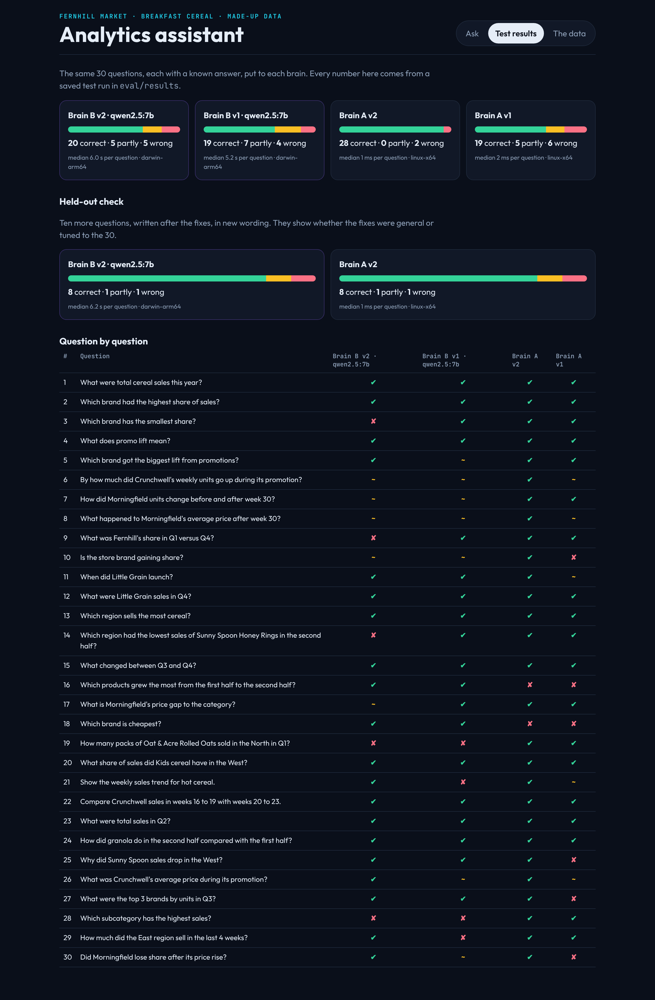

# Rules or AI? Measuring both on the same questions

A two-chapter case study. Chapter 1 is what happens at work, described in general terms. Chapter 2 is this public rebuild, with made-up data, where everything is measured.

## The short version

I gave two "brains" the same six data tools and the same 30 questions with known answers.

| | Correct | Partly | Wrong | Time per question (median) |
|---|---|---|---|---|
| Brain A (rules), v1 | 19 | 5 | 6 | 2 ms |
| Brain A (rules), v2 | 28 | 0 | 2 | 1 ms |
| Brain B (local AI, qwen2.5:7b), v1 | 19 | 7 | 4 | 5.2 s |
| Brain B (local AI, qwen2.5:7b), v2 | 20 | 5 | 5 | 6.0 s |
| **Held out:** Brain A v2, 10 new questions | 8 | 1 | 1 | 1 ms |
| **Held out:** Brain B v2, 10 new questions | 8 | 1 | 1 | 6.2 s |

What I took from it:

- **Rules win on the questions you built them for, and are thousands of times faster.** After fixing its two worst failure types, brain A got 28 of 30.
- **The fixes were partly tuned to the test.** On 10 new questions written afterwards, brain A got 8. New wording ("after its promotion ended", "the three biggest") still trips it.
- **The local AI handles wording it has never seen.** It answered "cheapest", "grew the most", "why" and "when" with no rules written for them. It also made up week numbers, picked the wrong measure, and sometimes ignored half the question.
- **Fixing an AI's instructions is not like fixing code.** Six general lines fixed five questions and broke four others. Net gain: one.
- **On new questions they tie (8 of 10 each)**, so the real choice is about cost and failure style: rules fail loudly ("I couldn't work out that question"), the AI fails quietly with a confident wrong number. That's why every answer on the screen shows the tool calls behind it.

## Chapter 1: at work

I work as a solutions engineer on a retail data team. Two things from that work led here.

**Using analytics tools from an AI assistant.** My team's analytics web app is available to AI agents as a set of typed tools, through MCP (Model Context Protocol, a standard plug that lets an AI call functions and get structured answers back). A platform team built that server. I didn't. I'm a daily user: I wired it into my own editor and ask it questions about categories and products while I work. Doing that every day taught me what makes a tool easy or hard for an agent: clear descriptions, flat arguments, errors that say how to fix the call, and a log of what actually ran.

**A rules-based copilot prototype.** For a hackathon I built a prototype that answers plain-English questions about a grocery category with fixed rules, no AI model, on purpose: for a demo, answers that are consistent and repeatable beat answers that are clever.

What I never had was a measurement. Was the rules approach better than letting a model call the tools? Nobody could say. Work data can't leave work, so I rebuilt the idea in public to find out.

## Chapter 2: the public build

Everything here is made up or written from scratch. No work code, data or names.

### The data

A year (52 weeks of 2025) of weekly breakfast cereal sales at **Fernhill Market**, a fictional grocer: six invented brands, sixteen products, four regions, 2,998 weekly rows, $1,764,523 in total. A fixed seed means every run gets the same numbers.

Five surprises are planted on purpose, so the tests know the truth:

1. Crunchwell ran a promotion in weeks 20 to 23. Units more than doubled.
2. Morningfield raised prices 12% from week 30. Its units fell about 18%.
3. Little Grain launched two products in week 40.
4. Fernhill, the store's own brand, gained share all year.
5. Sunny Spoon Honey Rings stopped selling in the West from week 35.

### Each number defined once

Sales, units, average price, share, price gap and promo lift are each defined in one file (`src/data/metrics.ts`), with a one-line meaning. The tools, both brains and the test answer key all use it, so two answers about "share" can never disagree. The first version measured a subcategory's share against itself (always 100%); a test caught it.

### Six tools, also an MCP server

`find_product`, `describe_metric`, `get_metric`, `compare_periods`, `list_events`, `what_changed`. All read-only (the database is opened read-only, and a test proves a delete fails), at most 60 rows per call, arguments checked before running, and every call logged. The same six run as an MCP server, so Claude Code or Cursor can use them directly.

### Two brains

**Brain A, rules.** Reads the question with keyword lists and patterns (which measure, which brand, which weeks), picks an answer shape (rank, compare, trend, define, event), calls the tools and fills in a sentence. If nothing matches, it says so.

**Brain B, local AI.** `qwen2.5:7b`, a 7 billion parameter model running on my Mac through Ollama (free, offline). It gets the question, a short description of the data and the six tools, decides which to call, reads the results and writes the answer. The model is a setting (`OLLAMA_MODEL`).

### How it was tested

30 questions written the way a category manager might ask. Each has an answer key worked out from the data. The scorer checks that the answer names the right things and contains the right numbers (within 2%): all checks pass is **correct**, at least half is **partly correct**, otherwise **wrong**. Then 10 more **held-out** questions, written after the fixes, to check the fixes weren't just tuned to the 30.

### Round one

**Brain A v1: 19 correct, 5 partly, 6 wrong.** It failed on:

- **events and relative time** (5 questions): "after week 30", "during its promotion", "after its price rise", "gaining share";
- **answer shapes it didn't have** (3): "when did it launch", "why did sales drop", "top 3";
- **word choice** (2): "cheapest", "grew the most";
- **a bug** (1): the row limit was 50, so a 52-week trend lost its last two weeks.

**Brain B v1: 19 correct, 7 partly, 4 wrong.** It sailed through the questions brain A couldn't parse, and failed on:

- **wrong weeks** (7): it guessed the promotion was weeks 30 to 39 instead of looking it up, put week 30 on the wrong side, misread "last 4 weeks";
- **wrong measure** (4): dollars when asked for packs, a total when asked for a trend.

### The fixes

**Brain A v2.** A sixth tool, `list_events`, finds promotions, lasting price changes, launches and products that stopped selling, from the data itself (nothing typed in by hand). Brain A uses it to turn "after its price rise" into weeks, and to answer "when" and "why". It also learned "top N" and yes/no answers. The row limit went to 60. I left the word-choice failures alone, to report them.

**Brain B v2.** Six general lines in its instructions: how to read "before and after week N" and "last N weeks", call `list_events` instead of guessing, which measure each word means, how to describe a trend, and don't split by region unless asked.

### Round two

**Brain A v2: 28 correct, 0 partly, 2 wrong.** Only the two word-choice questions left.

**Brain B v2: 20 correct, 5 partly, 5 wrong.** It fixed five questions (the promotion lift, the trend, the promotion price, "last 4 weeks", the share after the price rise), and four it had right went wrong. One of those it now answered "South" for a region question whose answer was West.

### The held-out check

**Brain A v2: 8 of 10. Brain B v2: 8 of 10.** Brain A misread "after its promotion ended" and didn't know "the three biggest". Brain B didn't name the product it found, and picked the wrong weeks for "after the promotion ended" too.

### Being honest about the numbers

- Each brain B version ran once. Small models vary from run to run, and I haven't measured how much.
- The scorer checks names and numbers, not reasoning. Checking by hand, two of brain B's "correct" answers are generous: one names the right product next to a wrong one, one gives the right price with the wrong weeks.
- I found a scorer bug while checking: "West" matched inside the word "lowest". Fixed to whole words, and every saved answer re-scored from its stored text. One verdict changed.
- Brain A was fixed while I could see the 30 questions. That's why the held-out set exists.
- Two infrastructure failures happened on the way: a Homebrew build of Ollama couldn't load models (0 of 30, because nothing ran, so that file was deleted and the eval now refuses to score a broken setup), and a `.gitignore` rule hid a source folder. Both are in [NOTES.md](NOTES.md).

### What I'd do next

- Run each brain B version five times and report the spread, not one number.
- Try brain B with brain A as a first pass: rules when they're confident, the model when they aren't.
- Grade answers on reasoning as well as numbers, by hand, for a sample.

## Claims ledger

Every claim on the portfolio page, and where its evidence is.

| Claim | Evidence |
|---|---|
| 2,998 weekly rows, $1,764,523 total | `npm run seed` output; `test/data.test.ts` |
| Five planted surprises, found from the data | `src/data/seed.ts` (`PLANTED`); `test/tools.test.ts` ("finds all five planted events") |
| Tools are read-only, max 60 rows, every call logged | `test/tools.test.ts` |
| The tools run as an MCP server | `test/mcp.test.ts` (starts the server as a real process and calls it) |
| Brain A v1: 19 / 5 / 6, median 2 ms | `eval/results/rules-v1.json` |
| Brain A v2: 28 / 0 / 2, median 1 ms | `eval/results/rules-v2.json` |
| Brain B v1 (qwen2.5:7b): 19 / 7 / 4, median 5.2 s | `eval/results/ai-qwen2.5-7b-v1.json` (run on the owner's Mac) |
| Brain B v2 (qwen2.5:7b): 20 / 5 / 5, median 6.0 s | `eval/results/ai-qwen2.5-7b-v2.json` (run on the owner's Mac, re-scored after the scorer fix) |
| Held out: both brains 8 / 1 / 1 | `eval/results/holdout/` |
| Brain B v2 fixed five questions and broke four | Question-by-question table in the two brain B result files |
| One verdict changed after the scorer fix | `eval/rescore.ts` output, in NOTES.md |
| 31 automated tests pass | `npm test` |
| Chapter 1 (work) | My own account. The platform team built the work MCP server; I use it and built the hackathon prototype. No numbers from work are claimed. |
