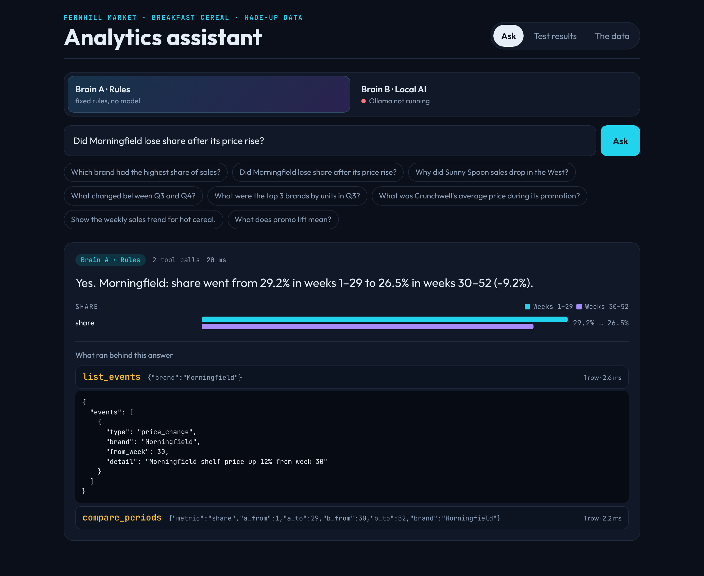

# Analytics assistant: rules versus a local AI, measured

Ask a plain-English question about a year of grocery sales and get an answer, a chart, and the exact list of tool calls behind it. Two "brains" can answer, on the same screen:

- **Brain A, rules.** No AI model. Fixed rules read the question (which measure, which brand, which weeks), call the tools and fill in a sentence.
- **Brain B, local AI.** A small AI model running on your own computer through [Ollama](https://ollama.com) (free, offline). It reads the question, decides which tools to call, and writes the answer.

Both use the same six tools, which are also offered as an **MCP server**. MCP (Model Context Protocol) is a standard plug that lets AI tools such as Claude Code or Cursor call functions you wrote and get structured answers back instead of guessing.

Then both brains sit the same test: 30 questions with known answers, scored correct, partly correct or wrong.

The data is made up: weekly breakfast cereal sales at **Fernhill Market**, a fictional grocer, with five surprises planted on purpose so the tests know the truth. See [CASE_STUDY.md](CASE_STUDY.md) for the full story and results.



## Run it

You need Node.js 22.13 or newer.

```bash
npm install
npm run seed       # builds data/cereal.db and lists the planted surprises
npm run web:build  # builds the screen
npm run server     # http://localhost:4300
```

## Turn on brain B (the local AI)

1. Install Ollama from https://ollama.com and start it (the app, or `ollama serve`).
2. Download the model, about 4.7 GB: `ollama pull qwen2.5:7b`
3. Restart `npm run server`. The switch shows a green dot when the model is ready.

The model is a setting. Any Ollama model that supports tools works:

```bash
OLLAMA_MODEL=llama3.1:8b npm run server
```

## Run the tests

```bash
npm test                              # 31 unit tests (brain B is tested against a stand-in, not a real model)
npm run eval -- rules --label v2      # brain A on the 30 questions
npm run eval -- ai --label qwen2.5-7b # brain B on the 30 questions (needs Ollama)
npm run eval -- rules --holdout       # brain A on 10 held-out questions
```

Results are saved in `eval/results/` and shown on the **Test results** tab.

## Use the tools from Claude Code (or any MCP client)

```bash
claude mcp add cereal -- npm --prefix "$(pwd)" run -s mcp
```

Then ask Claude Code something like "which cereal brand gained share after week 30?". Tools: `find_product`, `describe_metric`, `get_metric`, `compare_periods`, `list_events`, `what_changed`. All read-only, at most 60 rows per call.

## What's where

| Path | What it is |
|---|---|
| `src/data/seed.ts` | The made-up dataset and its planted surprises |
| `src/data/metrics.ts` | Every number, defined once (sales, units, average price, share, price gap, promo lift) |
| `src/tools/` | The six tools, and the MCP server that exposes them |
| `src/brains/rules.ts` | Brain A |
| `src/brains/ai.ts` | Brain B (Ollama) |
| `eval/` | The 30 test questions, 10 held-out ones, the scorer, and saved results |
| `web/` | The screen |

All rights reserved. See [LICENSE](LICENSE).
