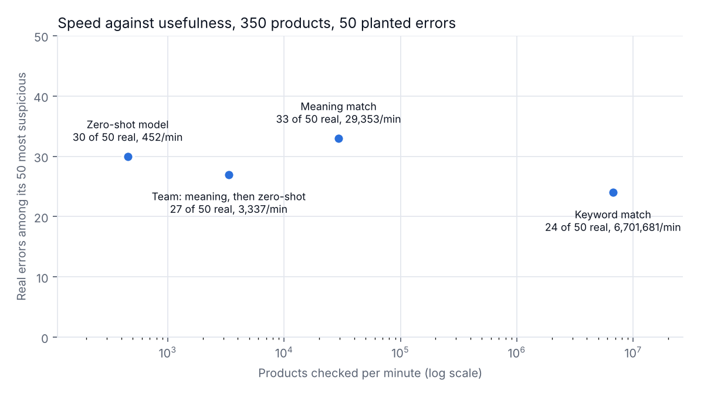

# Catching misfiled products: three checkers, measured

A two-chapter case study. Chapter 1 is the work problem, described in general terms. Chapter 2 is this public build on open data, where everything is measured.

## The short version

On 350 real grocery products, 50 of them deliberately filed in the wrong category:

| Checker | Real errors in its 50 most suspicious | Planted errors caught (anywhere in its flags) | False alarms | Products per minute |
|---|---|---|---|---|
| Keyword match | 24 | 50 of 50 | 164 | 6.7 million |
| Meaning match (small AI model) | **33** | 49 of 50 | 87 | 29,353 |
| Zero-shot model (large AI model) | 30 | 50 of 50 | 83 | 452 |
| Team: meaning match, then zero-shot for doubtful ones | 27 | 49 of 50 | 76 | 3,337 |

And at scale: **the team checked 5,000 products in 1.45 minutes on a laptop**, sending only 664 to the slow model. The old notebook this grew from took about twelve minutes for five.

What I took from it:

- **Catching errors is easy. Not crying wolf is hard.** Every checker caught nearly every planted error, but also flagged about a quarter of correct products. A review list of 1,366 products from 5,000 isn't a tool, it's a chore. The number that matters is how many of the top of the list are real.
- **The small, fast model ranked best**: 33 real errors in its top 50, at 29,353 products a minute. The large model was 65 times slower and slightly worse.
- **My team idea made the flag list shorter but the ranking worse**, because it mixed two kinds of score. Worth fixing; reported as it is.
- **The false alarms have a cause**: names that don't say what the product is ("Twiglets", "Goldfish", "VECTOR") and names in other languages. Short names are a third of the correct products but half of the false alarms. A checker that only reads the name can't fix that; it needs more information, such as ingredients.

## Chapter 1: at work

I work with retail product data. Products are filed into categories, and a misfiled product is invisible to anyone browsing or reporting on the right category. Checking by hand doesn't scale to large catalogues with new products arriving all the time.

Before this, I'd tried the idea in a notebook: a zero-shot language model scoring whether a product name fits its category. It worked on five examples and took about twelve minutes on a free notebook computer. It had no answer key, so there was no way to say how accurate it was, and no way to say whether it would cope with thousands of products. Chapter 2 is the version that answers both questions, on public data.

## Chapter 2: the public build

### The data

[Open Food Facts](https://world.openfoodfacts.org) is a free, open database of food products (ODbL licence). I downloaded products in 15 grocery categories (breakfast cereals, yogurts, cheeses, chocolates, pasta, coffees, teas, fruit juices, biscuits, crisps, sodas, breads, jams, soups, honeys) from the UK, US and Canada, keeping only products that belong to exactly one of the 15, so the label is unambiguous.

Open Food Facts was often busy (it answered "503" a lot), so the download retries with growing waits and lists any pages it had to skip.

### The answer key

350 products, spread evenly over the 15 categories: 300 with their own category and 50 moved to a random wrong one. We know exactly which 50 a checker should catch. Treating the database's own category as right is an assumption; a hand check of 50 products is set up to measure how often it's wrong (not yet filled in).

### The checkers

1. **Keyword match.** Does the category's word ("tea", "cheese") appear in the name?
2. **Meaning match.** A small model (`all-MiniLM-L6-v2`) turns names and categories into lists of numbers that capture meaning (embeddings) and checks which category is closest.
3. **Zero-shot model.** A large model (`bart-large-mnli`, the one from my old notebook) scores "This product is cheese" for each of the 15 categories, with no training on this data.
4. **Team.** Meaning match on everything. If the filed category comes 1st, pass; 4th or worse, flag; 2nd or 3rd, ask the zero-shot model.

The flag rules were written down before any real run and not tuned afterwards.

### Two measures, in plain words

- **Recall:** of the 50 planted errors, how many did it flag? (All four: 98 to 100%.)
- **Precision:** of everything it flagged, how much was really wrong? (All four: 23 to 39%.)

Because recall was near-perfect for everyone, I added a third measure after the first run: **of its 50 most suspicious products, how many are real errors?** That's what a person working down a review list experiences.

### Results

The table at the top. Speeds come from the second run; the first run, which included loading the models, measured meaning match at 9,931 a minute and the zero-shot model at 454.

### Why the team ranked worse than its parts

For most products the team's score is a meaning-match distance; for the doubtful ones it's a zero-shot probability. Those aren't on the same scale, so sorting by them muddles the top of the list. The team is still the cheapest way to get the shortest flag list (76 false alarms against 83 and 87), but for ranking, meaning match alone was best. The fix is to rescore everything on one scale.

### What the false alarms look like

From the run's own output: "Whole wheat fusilli" filed under Pasta was flagged as a breakfast cereal; "Twiglets" (crisps) looked like yogurt to the model; "Confiture d'abricot" (jam, in French) looked like a soda. 95 of the 300 correctly filed products have one- or two-word names; they make up 47% of meaning match's false alarms and 49% of the team's.

### The review list

`results/review_list.csv` lists the 1,366 flagged products from the 5,000, most suspicious first, each with a reason ("Filed under Biscuits, but "Chocolate wafer" reads more like Chocolates"). Near the top it surfaces genuinely ambiguous products: chocolate-covered biscuits, cheese crackers, coffee energy drinks. Those aren't wrong so much as products that belong in two places, which is a real catalogue question in its own right.

### What I'd do next

- Rescore the team on one scale, and re-measure its top 50.
- Give the checkers the ingredients list as well as the name, for products whose names say nothing.
- Fill in the hand check, to measure how often the source data itself is wrong.
- Plant harder errors (a near category, such as biscuits filed as chocolates), since random wrong categories are easy.

## Claims ledger

| Claim | Evidence |
|---|---|
| 350-product answer key, 50 planted errors | `data/answer_key.csv`; `tests/test_pipeline.py` |
| Flag rules fixed before the run | README (rules section) and `catalogue/checkers.py`, unchanged since the first commit |
| Top-50 results: 24 / 33 / 30 / 27 | `results/eval.json` (second run, owner's Mac) |
| Caught 50 / 49 / 50 / 49, false alarms 164 / 87 / 83 / 76 | `results/eval.json` (identical in both runs) |
| Speeds 6.7 million / 29,353 / 452 / 3,337 per minute | `results/eval.json`; first-run speeds in NOTES.md |
| 5,000 products in 1.45 minutes, 664 to the slow model, 1,366 flagged | `results/scale.json` |
| Short names: 95 of 300 correct products, 47% / 49% of false alarms | Counted from `results/eval_rows.csv`, method in NOTES.md |
| Old notebook: about twelve minutes for five products | The old notebook's own notes |
| Chapter 1 (work) | My own account. No work data, code or numbers are used. |
