# Customer data delivery: messy weekly files in, one trusted table out

A two-chapter case study. Chapter 1 is the work I do around data deliveries, described in general terms. Chapter 2 is this public build, with made-up pharmacies, where every step can be run and checked.

## The short version

Three pharmacies send their weekly sales in three different formats, each with its own mess. Every Monday the pipeline turns them into one clean, tested table, and **delivers only if every check passes.** Over six made-up weeks with five planted problems:

| Week | What went wrong | What happened |
|---|---|---|
| W36, W37 | nothing | delivered |
| W38 | Northside added a column, shifting every column after it | stopped: "file's columns changed", with the column named |
| W39 | Valley's file was late; Harbour resent 37 rows | waited; delivered when the file arrived, with the 37 copies removed |
| W40 | Harbour sent 12 order lines twice with different amounts; Valley dated 6 sales 2062 | stopped, with the line IDs for both |
| W41 | Northside's file was cut short (90 rows, normally about 1,000) | stopped: "row count in normal range" |

Every planted problem was caught with the right customer and the right reason, and nothing wrong was ever delivered.

**Onboarding a fourth customer:** with a helper that reads one of their files and drafts the settings file, it took **37 seconds from draft to delivered, on the first try, with no changes to the draft** (timed by me, from the terminal's own clock). With the blank template it didn't happen at all: I couldn't tell what to type.

## Chapter 1: at work

Part of my work involves a recurring data delivery: our data lands in cloud storage on a schedule, and an external team builds a customer-facing product on top of it. I didn't build that pipeline, but I know how it works end to end, I'm involved in the process around it, and I've seen what matters to the people on the receiving end: the data has to arrive on time, in the agreed shape, and above all be right. A late delivery can be explained. A wrong one gets used.

That's the part I wanted to build myself, in public: the checks and the "stop if anything's off" behaviour, plus the question every growing data team runs into, which is how much effort each new customer costs.

## Chapter 2: the public build

### The setup

Three made-up pharmacies, each with its own export:

| Customer | Format | Dates | Numbers |
|---|---|---|---|
| Northside Pharmacy | comma-separated | 2026-09-14 | 12.50 |
| Harbour Chemists | semicolon-separated | 14/09/2026 | 12,50 |
| Valley Drug Co | one JSON record per line | 09-14-2026 | 12.50 |

Each has a **settings file** (`customers/*.yaml`) describing its file name, format, date style, which of its columns means what, and a normal weekly row count. Six weeks of files are generated by code with a fixed seed, so anyone can recreate them, problems included.

### The flow

1. **Load.** Find each file, check its header against the settings file, map the columns, read the dates and numbers, write to DuckDB (a free database that runs on a laptop; I chose it over a Snowflake trial because it's free for good and its SQL is close to Snowflake's). Missing or wrong-shaped files are recorded, not loaded. Reloading a week replaces it, so reruns never double anything.
2. **Clean and test with dbt** (a tool that builds clean tables from raw ones using plain SQL, with tests). Exactly repeated rows are removed. Then: no empty IDs, dates, units or revenue; one row per order line; every sale inside the week; each customer's row count within its normal range.
3. **Deliver or block.** All loaded and all tests passed: write the week's table. Anything else: write nothing, and raise an alert naming the customer, the check, and what to look at first.
4. **Schedule with Dagster.** Every Monday at 06:00. If a file is late it waits and retries, six times, ten minutes apart. Every run is kept in a history.
5. **The board.** A single page, styled like a departures board, showing every customer for every week.

### Two decisions worth explaining

**Exact copies are cleaned; different copies stop the delivery.** Harbour resent 37 rows identically in W39. Dropping them is safe, and the board shows the count so a person notices if it grows. In W40 Harbour resent 12 lines with different amounts. There's no way to know which is right, so the delivery stops and a person asks.

**One bad customer holds the whole week.** In W38 only Northside was wrong, but Harbour and Valley were held too ("clean, held with the rest of the week"). The receiving team gets one complete table or nothing, never a table that's silently missing a customer. A real contract might prefer partial deliveries with a clear flag; that's a setting I'd agree with the customer, not a default.

### Onboarding customer four

The real test of "a settings file, not new code": Lakeshore Pharmacy sends tab-separated files, with columns called "Receipt Line" and "Pieces", dates like 14.09.2026, and files named `LKS_2026_W37.tsv`.

Two things came out of it:

1. **The file naming broke the settings format.** A dry run showed `{week}` can only produce `2026-W37`, not `2026_W37`. I added `{year}` and `{wk}` placeholders. A config gap found by trying, not by guessing.
2. **The blank template was too hard.** When I sat down to fill it in for real, I couldn't: it asks for codes like `%d.%m.%Y` without saying how to find them. So I built `delivery.onboard`, which reads one of the customer's files and drafts the settings file with a note on every guess. On the three existing customers it drafts the same column mapping I'd written by hand (tested). Its first version set the normal row range from the smallest to the largest file, which would have accepted Northside's partial file; it now uses a typical file and warns about odd ones (tested).

With the helper: drafted at 00:20:02, delivered at 00:20:39. **37 seconds, first try, no changes to the draft.**

### When things go wrong

[docs/RUNBOOK.md](docs/RUNBOOK.md) has ten entries, one per way a delivery day goes wrong: what you see, what's wrong, what to check first, how to fix it. The first six are the planted problems, so every entry can be caused and practised.

### What didn't work

- Dagster's web screen wouldn't render in the build sandbox's headless browser, so there's no screenshot of it here. The Dagster runs themselves worked: W37 succeeded, and W40 and W41 failed with "Delivery blocked" and the reasons.
- The first full run delivered W39 when it shouldn't have, because the late file was left over from a test. The generator now clears it, and the run was repeated from clean.

### What I'd do next

1. Let a contract choose per-customer partial delivery, with the missing customers flagged in the output.
2. Compare each week with the last (a sudden 40% drop in one store is worth a look even inside the normal range).
3. Point my data lineage explorer at this project's real dependency graph.

## Claims ledger

| Claim | Evidence |
|---|---|
| Every planted problem caught with the right customer and reason | `tests/test_delivery.py` (one test per problem); `docs/first-run-output.txt` |
| Nothing wrong delivered: blocked weeks have no output file | `delivered/<week>/` (no `weekly_sales.csv` for W38, W40, W41); tested |
| 37 resent rows removed in W39 (693 loaded, 656 delivered) | `delivered/2026-W39/status.json`; tested |
| Reruns never double rows | `test_reloading_a_week_never_doubles_rows` |
| Onboarding: 37 seconds draft to delivered, first try, no changes | My terminal output (00:20:02 to 00:20:39); `customers/lakeshore.yaml` as drafted |
| Blank template: couldn't fill it in | My first attempt, recorded in NOTES.md |
| Helper drafts the same mapping as hand-written settings | `test_onboarding_helper_drafts_the_same_settings_as_written_by_hand` |
| Dagster: Monday 06:00 schedule, 6 retries, run history | `orchestration/definitions.py`; command-line runs in NOTES.md |
| 15 automated tests | `python -m pytest` |
| Chapter 1 (work) | My own account. I didn't build the work pipeline; no names or numbers from work are used. |
