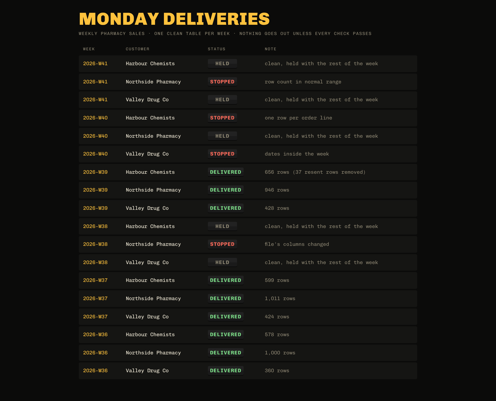

# Customer data delivery

Three pharmacies send their weekly sales files, each in their own format and with their own mess. Every Monday this turns them into one clean, tested table, and delivers it only if every check passes. Adding a fourth pharmacy takes a settings file, not new code.

All the pharmacies and data are made up, generated by code so anyone can recreate them.



## How it works



1. **Settings file per customer** (`customers/*.yaml`): how their file is named, which delimiter, decimal and date format, which of their columns means what, and a normal weekly row count.
2. **Loader** (`delivery/load.py`): finds the file, checks the header matches, maps their columns to ours, reads their dates and numbers, and writes to a DuckDB warehouse (a free database that runs on your laptop). Missing or wrong-shaped files are noted, not loaded. Reruns replace, never double.
3. **dbt** (`dbt_project/`): a tool that turns raw tables into clean ones with plain SQL, and tests them. Exact resent rows are removed. Tests: no empty IDs, dates, units or revenue; one row per order line; every date inside the week; row count in the customer's normal range.
4. **Deliver or block** (`delivery/deliver.py`): if every customer loaded and every test passed, `delivered/<week>/weekly_sales.csv` is written. Otherwise nothing is delivered, and the alert says which customer, which check, and what to look at first.
5. **Dagster** (`orchestration/`): runs it every Monday at 06:00, waits and retries when a file is late, and keeps a history of every run.
6. **The board** (`delivered/board.html`): every week, every customer, at a glance.

When something goes wrong, see [docs/RUNBOOK.md](docs/RUNBOOK.md).

## Run it

Needs Python 3.11 or newer.

```bash
python3 -m venv .venv && source .venv/bin/activate
pip install -r requirements.txt
python -m delivery.generate            # six weeks of messy files
python -m delivery.deliver --all       # deliver (or block) every week
python -m delivery.generate --arrive   # the late file finally arrives
python -m delivery.deliver --week 2026-W39
open delivered/board.html
```

Schedule and run history: `dagster dev -m orchestration.definitions`, then open http://localhost:3000.

Tests: `python -m pytest` (11 tests, about a minute).

## Onboard a new customer

```bash
python -m delivery.new_customer                        # Lakeshore's first files arrive
cp customers/_template.yaml customers/lakeshore.yaml   # fill it in by looking at a file
python -m delivery.deliver --week 2026-W37
```

All rights reserved for the code. See [LICENSE](LICENSE).
