# Fast decision models, measured

**Draft, 2026-10-11.** Sections marked *pending* wait for the model runs on the owner's Mac. Nothing below is a result until it has a number from a run in this repo.

## The short version

*Pending.* Will hold one table: each contender's urgent and team accuracy, how far off its frustration score is, its speed, its cost, and how honest its confidence is, on the 50 held-out requests. Then three or four plain takeaways.

## Chapter 1: why I built this

This is a personal project. In 2026 a new kind of model appeared: "decision models" (also called System One models) that don't write text, they only answer typed questions (yes or no, pick one of these, rate this 1 to 5) and say how sure they are. TypeSafe's Jev is the paid, hosted one; within weeks several open ones followed (Kev, Strands Decider, Laya, Clef). Most claims about them come from their makers.

I wanted to know two things I couldn't find answered independently, on a task I understand:

1. Can a small, cheap model make routine support decisions about as well as a bigger one?
2. When it says it's 90% sure, is it right 90% of the time? If the confidence is honest, you can let the model handle the sure cases and send the rest to something slower, or to a person.

It builds on two of my earlier projects: the answer-key scoring from the analytics assistant, and the fast-then-slow "team" idea from the catalogue checker.

## Chapter 2: the build

### The test set

250 made-up support requests to a fictional company (placeholder name Quillstack, a scheduling and invoicing app for small businesses). I wrote the labelling rules first (`docs/labelling-rules.md`), then the requests, each with an answer for three questions:

- **Urgent?** Needs a person today. Angry tone alone doesn't count.
- **Which team?** One of eight. With two problems in one message, the one that most blocks the customer.
- **How frustrated?** 1 (calm) to 5 (furious). Sarcastic praise counts as frustration.

35% are hard on purpose: two problems in one message, sarcasm, very short messages, non-native English. 200 are for development; 50 were held out and scored once at the end.

### One interface for everyone

Every contender gets the same request in the same shape (the System One shape from Jev's public docs) and must answer in that shape. A checker rejects any answer that is malformed: missing answers, probabilities that don't add up, a pick that isn't the most likely option. So nobody gets scored on a broken answer. One shared set of tests runs against every contender.

### The contenders

| Contender | What it is | Licence | Where it ran |
|---|---|---|---|
| Even odds | The floor: knows nothing | n/a | cloud container |
| Rules | Keyword lists, written from the labelling rules | n/a | cloud container |
| *pending* | Ollama `qwen2.5:7b`, asked for probabilities | Apache-2.0 (to confirm) | owner's Mac |
| *pending* | Kev, Strands Decider, Laya (see `docs/models.md`) | to confirm on each model card | owner's Mac |
| Jev | Paid API; only if a key is supplied | commercial | not run |

### Measuring

Accuracy for each question; accuracy on each team; for frustration, the average distance from the right level; seconds per request; cost per 1,000 requests (local runs: no charge per request, said plainly). And **calibration**: answers grouped by how sure the contender said it was, against how often each group was right.

### Fast then slow

The fast contender answers everything. If its least sure answer for a request falls under a threshold, the whole request goes to the slow one. The threshold rule was written down before any model ran: the lowest threshold where urgent and team accuracy are both within 0.02 of the slow model alone. It's fixed on the development set and then used once on the held-out set.

*Pending:* how many requests were handed over, accuracy, and time saved.

### What I found

*Pending.*

### Limits

- One author wrote and labelled every request in one sitting; a real queue is messier and more varied.
- Only 9 requests are at frustration level 5, so results at that level are noisy.
- The rules were written while looking at the development set, so their development numbers are optimistic. The held-out set is the fair comparison.
- Each project defines "confidence" its own way; we measure what each says against what happens, on the same requests.
- We test the public System One pattern. Nothing here claims to know how Jev works inside.

## Claims ledger

Every claim on the portfolio page, and where its evidence is.

| Claim | Evidence |
|---|---|
| 250 requests, 200 dev / 50 held-out, 35% hard cases | `python3 scripts/build_testset.py` output; `data/dev.jsonl`, `data/heldout.jsonl` |
| Labelling rules written before labelling | `docs/labelling-rules.md`; commit history |
| Every answer checked against the System One shape | `systemone/schema.py`; `tests/test_schema.py`, `tests/test_contract.py` |
| Jev never called without the owner's key and switch | `systemone/adapters/jev.py`; `tests/test_adapters.py` |
| Threshold rule fixed before any model run | `scripts/cascade.py` docstring; NOTES.md, 2026-10-11 |
| Rules on dev: urgent 0.82, team 0.73 (optimistic) | `results/dev/rules.json` (cloud container) |
| *pending*: every model result | `results/dev/*.json`, `results/heldout/*.json`, with machine named |
| *pending*: model licences | `docs/models.md`, after checking each model card |
